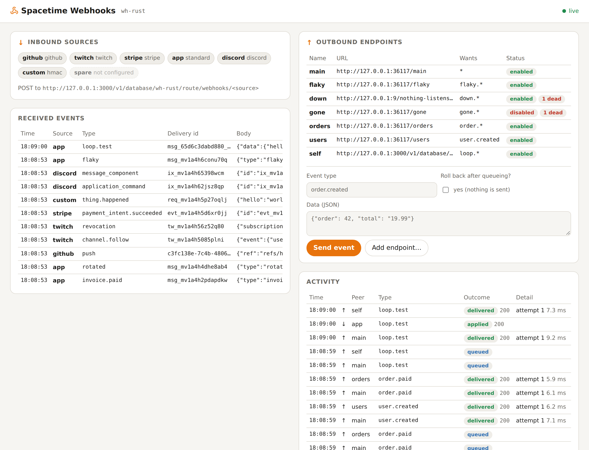
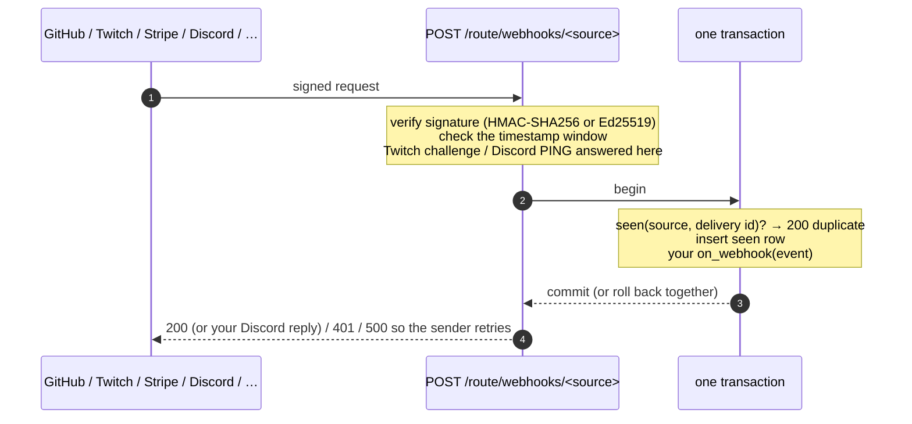

<div align="center">

# 🔧 Spacetime Webhooks

**Verified inbound and signed outbound webhooks for Spacetime.**

Receive webhooks from GitHub, Twitch EventSub, Stripe, Discord, any Standard Webhooks sender or a generic HMAC
signer, with signature checks, replay windows and exactly-once handling in the same transaction as your change.
Send your own, signed per the [Standard Webhooks](https://www.standardwebhooks.com) spec, from a transactional
outbox with retries, backoff and dead letters. Available for **Rust**, **C#** and **TypeScript (as a submodule)**,
with the same routes, headers and behaviour in all three.

[](https://github.com/Gazz-Stripbolt/spacetimedb-webhooks/actions/workflows/ci.yml)


[](https://www.npmjs.com/package/@pogly/spacetimedb-webhooks)


[](LICENSE)

<picture>
  <source media="(prefers-color-scheme: dark)" srcset="docs/dashboard-dark.png">
  
</picture>

</div>

---

## Where to go

| I want… | Go to |
|---|---|
| **Rust**: add webhooks to a Rust module | [`rust/`](rust): `webhooks.rs`, one drop-in file |
| **C#**: add webhooks to a C# module | [`csharp/`](csharp): `Webhooks.cs`, one drop-in file |
| **TypeScript**: add webhooks to a TS module, as a **submodule** | [`typescript/`](typescript): `npm install @pogly/spacetimedb-webhooks` ([npm](https://www.npmjs.com/package/@pogly/spacetimedb-webhooks)) |
| **See it working**: a module receiving from six kinds of sender and sending its own | [`demo/`](demo): the same demo in each language, with a live dashboard |
| **Every header, signature and status code** | [`docs/PROTOCOL.md`](docs/PROTOCOL.md) |
| **What we learned**: numbers, limits, Spacetime quirks | [`docs/FINDINGS.md`](docs/FINDINGS.md) |

CI runs the same 19-test end-to-end suite (real signed requests, a real receiver) against every language:

| | Rust | C# | TypeScript submodule |
|---|---|---|---|
| Inbound: 6 verifiers, replay windows, dedupe, rollback-on-error, Twitch challenge, Discord PING | ✅ | ✅ | ✅ |
| Outbound: Standard Webhooks signing, retries, dead letters, 410 Gone, filters, transactional outbox | ✅ | ✅ | ✅ |

## Inbound



| Kind | Verifies | Delivery id | Event type | Replay window |
|---|---|---|---|---|
| `standard` | `webhook-signature: v1,<base64>` over `id.timestamp.body` (multiple signatures OK) | `webhook-id` | body `type` | 5 min |
| `github` | `X-Hub-Signature-256: sha256=<hex>` over the body | `X-GitHub-Delivery` | `X-GitHub-Event` | none (GitHub signs no timestamp) |
| `twitch` | `Twitch-Eventsub-Message-Signature` over `id + timestamp + body`; answers the challenge | `Twitch-Eventsub-Message-Id` | subscription type, or `revocation` | 10 min |
| `stripe` | `Stripe-Signature: t=..,v1=..` over `t.body` | body `id` | body `type` | 5 min |
| `discord` | Ed25519 over `timestamp + body`; answers PING | body `id` | `application_command`, `message_component`, … | 5 min |
| `hmac` | any header / prefix / hex or base64 you configure | your id header, or the body hash | your type header | none |

Sources come from one env var, so secrets never live in your code or tables:

```bash
WEBHOOK_SOURCES='{"github":{"kind":"github","secret":"..."},
                  "twitch":{"kind":"twitch","secret":"..."},
                  "discord":{"kind":"discord","public_key":"<hex>"}}' spacetime publish my-db
```

Your handler runs in the dedupe transaction. **Throw/return an error and nothing is recorded**: the sender gets a
500, retries, and the retry is applied fresh. Return a JSON string to reply (Discord interactions).

## Outbound

```rust
webhooks::add_endpoint(ctx, "billing", "https://example.com/hooks", "whsec_...", &["order.*"])?;
// inside any reducer: queued in your transaction, delivered right after it commits
webhooks::send(ctx, "order.paid", json!({ "order": 42 }));
```

- **Transactional outbox:** the event exists if and only if your change commits.
- **Push, not poll:** each send schedules a one-shot procedure for *now*. In tests the receiver sees the POST
  ~10-20 ms after the request that queued it.
- **Standard Webhooks:** `webhook-id` (stable across retries, so receivers dedupe), `webhook-timestamp`,
  `webhook-signature: v1,<base64>`, body `{"type", "timestamp", "data"}`. Any Standard Webhooks library verifies it.
- **Retries** on any non-2xx or transport error (default 5 s, 30 s, 2 m, 10 m, 30 m, 1 h, 2 h, 4 h), then a dead
  letter you can redeliver. **410 Gone** disables the endpoint. Per-endpoint event filters: `order.paid`,
  `order.*`, `*`.

## Quick start (Rust)

```rust
// Cargo.toml: spacetimedb = { version = "2.14.*", features = ["unstable"] }, plus serde_json, http, hmac,
// sha2, base64 and ed25519-dalek (see demo/rust/Cargo.toml)
pub mod webhooks;   // copy rust/webhooks.rs to src/webhooks.rs

#[spacetimedb::reducer(init)]
pub fn init(ctx: &ReducerContext) { webhooks::init(ctx); }

pub fn on_webhook(ctx: &ReducerContext, ev: &webhooks::WebhookEvent) -> Result<Option<String>, String> {
    if ev.source == "github" && ev.event_type == "push" { /* update your tables */ }
    Ok(None)
}

#[spacetimedb::http::router]
fn routes() -> Router { webhooks::router(&["github", "twitch", "discord"]) }
```

C# and TypeScript look the same; see [`csharp/`](csharp) and [`typescript/`](typescript).

## Good to know

- **Needs a 2.14 host.** Modules built with the 2.14 libraries export a changed HTTP handler ABI, and older hosts reject
  them ([release notes](https://github.com/clockworklabs/SpacetimeDB/releases/tag/v2.14.0)).
- **Secrets live in env vars** (`WEBHOOK_SOURCES`) for inbound, and in a private table for outbound endpoints.
  Generate outbound secrets outside the module: module RNGs are seeded from the timestamp.
- **HTTP handlers are beta** in Spacetime 2.14 (Rust needs the `unstable` feature). Route paths must be
  lowercase without dots, so source names follow the same rule.
- **Locally**, standalone refuses module HTTP to loopback and private addresses. That's fine for real endpoints;
  the tests use a build that allows it ([`scripts/dev-server.sh`](scripts/dev-server.sh)).
- The demo's dashboard and `/demo/*` routes are open to anyone: they're for trying it out, not for production.

## Repository layout

```
rust/webhooks.rs        Rust drop-in
csharp/Webhooks.cs      C# drop-in (managed SHA-256/512 and Ed25519: no System.Security.Cryptography on wasi)
typescript/             TypeScript submodule (package: spacetimedb-webhooks)
demo/{rust,csharp,typescript}   the demo module in each language
demo/dashboard/         the live dashboard every demo serves at /route/
tests/                  e2e suite (signers checked against official test vectors), throughput bench
scripts/                dev-server.sh · e2e.sh · bench.sh
docs/                   PROTOCOL.md · FINDINGS.md · screenshots
```

## Credits

Built by **Tinker** ([@Gazz-Stripbolt](https://github.com/Gazz-Stripbolt)), the resident gadgeteer for the
[Pogly](https://pogly.gg) team: collaborative stream overlays, powered by Spacetime. Twitch EventSub straight
into a module is exactly what Pogly needs.

More Spacetime building blocks from this workshop: **[github.com/Gazz-Stripbolt](https://github.com/Gazz-Stripbolt)**.

🚀 **New to Spacetime?** If you sign up through **[this referral link](https://spacetimedb.com/?referral=Lethalchip)**,
Pogly gets free recurring energy. Thank you!

## License

[MIT](LICENSE)
